# IT Tools on AWS ECS Fargate

I took an open source app, IT Tools, put it in a container and deployed it on AWS ECS Fargate behind a load balancer with HTTPS on my own domain: **https://tm.ezanstoic.org**

I built it by hand in the AWS console first, then rebuilt all of it in Terraform, then put GitHub Actions pipelines on top to deploy, check and destroy it. The pipelines log in to AWS with OIDC, so there are no AWS keys stored in GitHub.

The site is only up while I have it deployed. I destroy it between sessions to avoid paying for the load balancer, so the link may not load if you try it later. The screenshots below show it running.

## Overview

IT Tools is an open source collection of small utilities that developers and sysadmins use all the time: a hash generator, a JSON formatter, a base64 encoder and decoder, a UUID generator, a JWT decoder, a cron expression helper, a colour converter and a lot more. It is written in Vue 3 and built with Vite. The build gives you a folder of plain HTML, CSS and JavaScript files, and everything runs in the browser. Nothing you type is sent to a server, and there is no database or login, so a simple nginx container is enough to serve it.

I picked it because I wanted something people would really use, but simple enough that the app itself wasn't the hard part. This project is about the infrastructure: networking, load balancing, HTTPS, containers and pipelines. Because the app is stateless, the whole environment can be destroyed and rebuilt from the repo at any time without losing anything, which suits infrastructure as code well.

I hosted it on ECS rather than a VM or something like Vercel because those hide the parts that matter in a production setup. Vercel or Netlify would host it in a few clicks, but that isn't how a company runs its own services on AWS. A VM would work, but I'd be patching the operating system, installing Docker, starting the container by hand and noticing when it dies. With Fargate I hand AWS a container image and it runs it, replaces it if it fails and connects it to the load balancer, with no servers for me to look after. It also fits with the rest of AWS (IAM, ACM certificates, CloudWatch logs), which is how real setups are built.

This deployment is a demo, so traffic is light: a handful of visitors at a time. I sized it as if it were an internal tool for a team of around a hundred developers. One or two small Fargate tasks would handle that comfortably because the app only serves static files, and auto scaling could be added if traffic ever called for it.

## Demo

The app running over HTTPS on my domain:


The padlock and certificate in the browser:

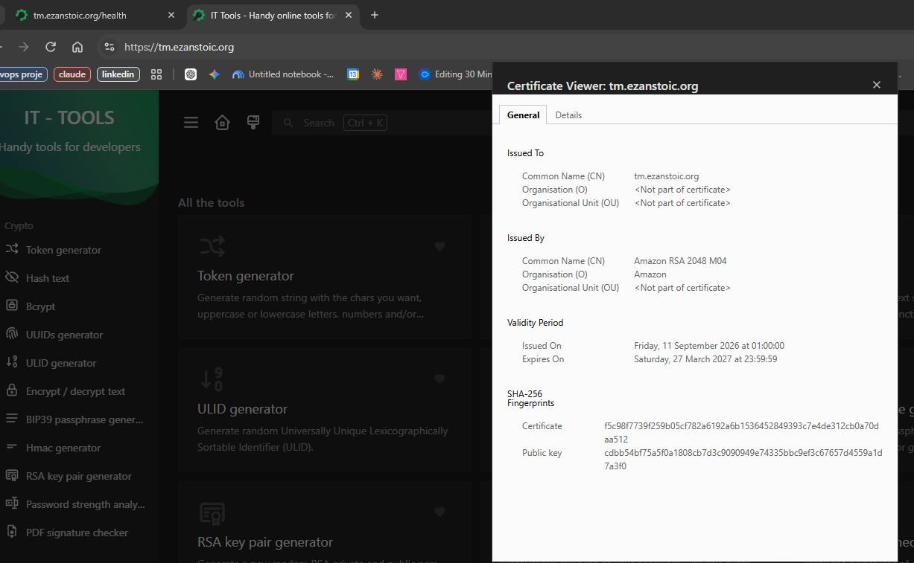

## Local setup

You need Docker.

```bash
docker build -t it-tools ./app
docker run --rm -p 8080:8080 it-tools
```

Open http://localhost:8080 and the app loads. `http://localhost:8080/health` is the path the load balancer uses for its health check.

The Dockerfile is a two-stage build. The first stage uses Node to build the app. The second stage copies only the finished static files into `nginx-unprivileged`, which runs as a non-root user on port 8080. The final image doesn't contain Node or the source code.

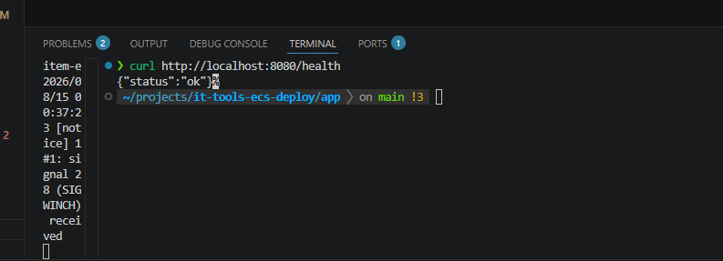

## Architecture

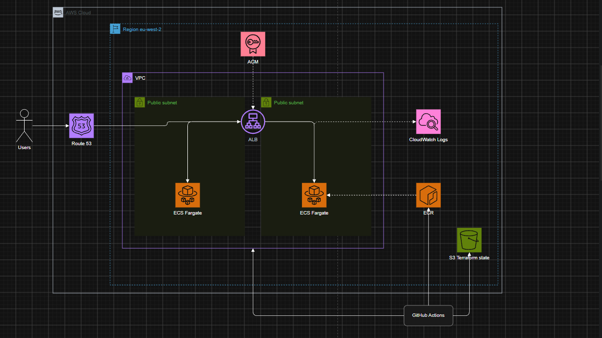

Users look up `tm.ezanstoic.org` in Route 53, which points at the Application Load Balancer. The load balancer sits in the public subnets, uses an ACM certificate to serve HTTPS on port 443, and redirects port 80 to 443. It forwards traffic to the Fargate tasks on port 8080 and checks `/health` to know whether each task is okay. The tasks pull their image from ECR and send their logs to CloudWatch. The Terraform state lives in an S3 bucket, and GitHub Actions deploys everything using short-lived credentials from OIDC.

I used public subnets for the tasks. That means they can reach ECR without a NAT gateway, which would add about $30 a month. The tasks are still not open to the internet, because their security group only accepts traffic from the load balancer's security group. For a real production workload I would move them to private subnets with a NAT gateway or VPC endpoints.

## Built by hand first

Before writing any Terraform I built the whole thing in the AWS console, then tore it down. Doing it by hand first meant I understood what each piece was for when I turned it into code.

| | |
|---|---|
| 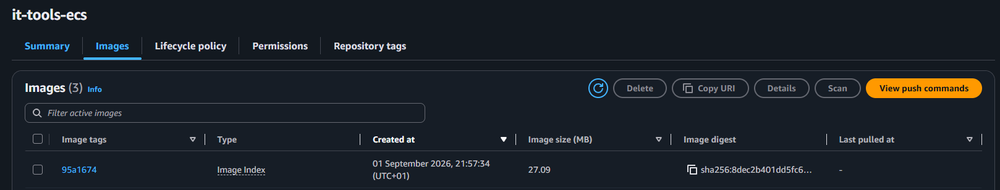 | 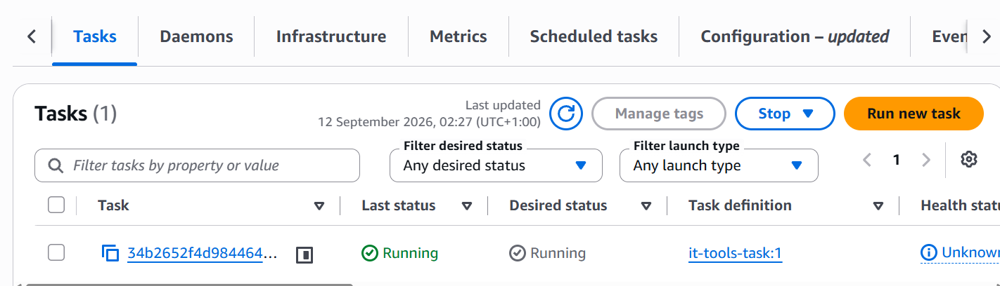 |
| 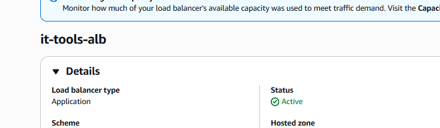 | 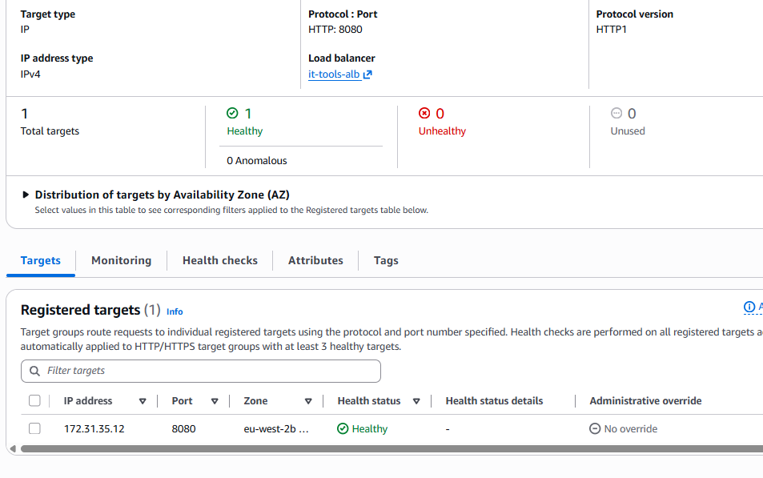 |
| 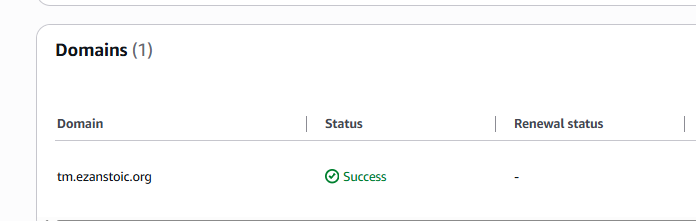 | 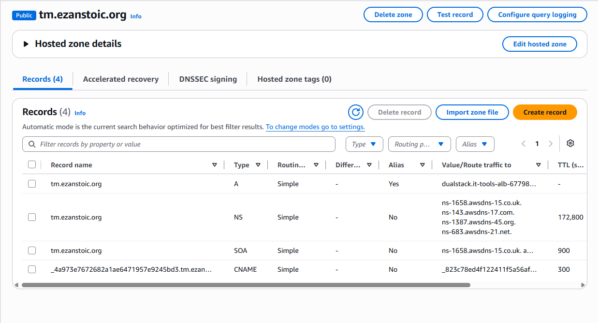 |

## Project structure

```
.
├── app/                         # IT Tools source, Dockerfile, nginx.conf, .dockerignore
├── terraform/
│   ├── main.tf                  # wires the modules together, plus the Route 53 record
│   ├── provider.tf              # AWS provider and S3 backend
│   ├── variables.tf
│   ├── outputs.tf
│   ├── bootstrap/               # one-off: creates the S3 bucket for Terraform state
│   ├── oidc/                    # separate Terraform: GitHub OIDC provider and pipeline roles
│   └── modules/
│       ├── vpc/                 # VPC, public subnets, internet gateway, routes
│       ├── ecr/                 # image repository
│       ├── acm/                 # certificate and DNS validation
│       ├── alb/                 # load balancer, listeners, target group, security group
│       └── ecs/                 # cluster, task definition, service, IAM, log group
├── .github/workflows/
│   ├── app.yml                  # build image, push to ECR
│   ├── terraform-plan.yml       # fmt, validate and plan on pull requests
│   ├── terraform-deploy.yml     # apply, push image, health check
│   └── terraform-destroy.yml    # manual teardown
├── images/                      # screenshots and diagram used in this README
└── README.md
```

The OIDC roles are in their own Terraform folder on purpose. If they were part of the main stack, the destroy pipeline would delete the role it is logged in with halfway through the run.

## Terraform state

State is stored remotely in an S3 bucket (versioned, encrypted, public access blocked). Locking uses S3's native lockfile (`use_lockfile = true`), so no DynamoDB table is needed. The bucket is created once by the code in `terraform/bootstrap`.

## Pipelines

All of them log in with OIDC. GitHub gives each job a short-lived token, and AWS only hands out temporary credentials if the token comes from this repository and the `main` branch.

**App image** builds the Docker image and pushes it to ECR, tagged with the short commit SHA and `latest`.

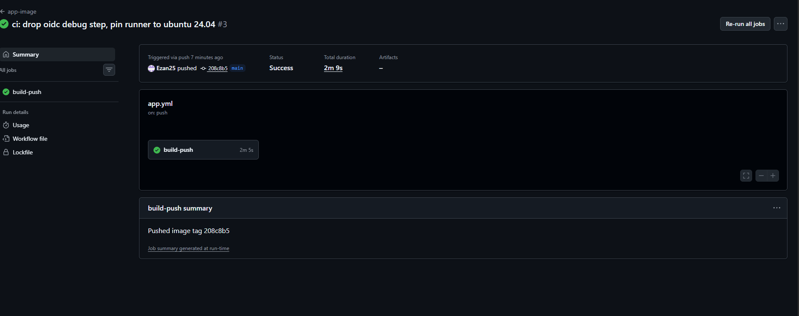

**Terraform plan** runs on pull requests that change `terraform/`. It checks formatting, validates the code and runs a plan, so I can see what would change before anything is applied.

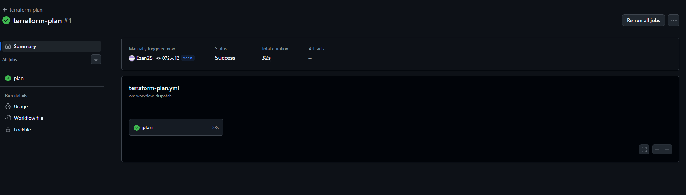

**Terraform deploy** applies the Terraform, builds and pushes the image, forces a new ECS deployment and then keeps calling `https://tm.ezanstoic.org/health` until it answers. If it never does, the pipeline fails. A full build from nothing takes about six minutes. I run it manually with `workflow_dispatch` rather than on every push, because every deploy costs money.

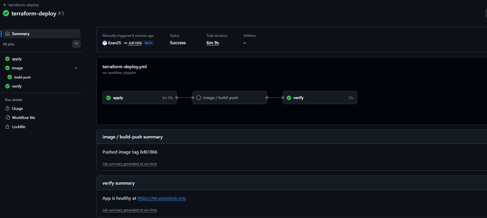

**Terraform destroy** removes everything. It only runs if you type `destroy` into the confirmation box, so a stray click can't delete the stack. It takes about eight minutes, mostly waiting for the ECS service to drain.

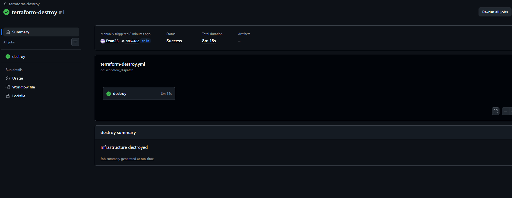

Deploy and destroy share a concurrency group, so they can never run at the same time.

## Run it yourself

You need an AWS account, Terraform 1.10 or newer (S3 native locking needs it), the AWS CLI and a Route 53 hosted zone for your domain.

1. Change `domain_name` in `terraform/variables.tf` (and the region if you don't use `eu-west-2`).
2. Create the state bucket with `cd terraform/bootstrap && terraform init && terraform apply`. Put the bucket name into the backend blocks in `terraform/provider.tf` and `terraform/oidc/provider.tf`.
3. Create the pipeline login with `cd terraform/oidc && terraform init && terraform apply`. In `main.tf`, set `repo` to your own GitHub repository. GitHub's token subject now uses the owner and repository IDs, so use that format.
4. Copy the two role ARNs from the outputs into the `role-to-assume` lines in the workflows.
5. In GitHub, go to Actions, pick `terraform-deploy` and run it.
6. When you've finished, run `terraform-destroy` and type `destroy`.

## Security

- No AWS access keys anywhere. The pipeline roles only trust this repository, and the ones that change infrastructure only trust the `main` branch.
- The container runs as a non-root user, and the tasks only accept traffic from the load balancer.
- ECR scans every image on push.
- The Terraform role is limited by service (EC2, ELB, ECS, ECR, ACM, Route 53 and logs), and IAM is limited to roles named `it-tools-ecs-*`.

## Cost

Left running, the load balancer and the Fargate task cost about $35 to $40 a month. The VPC and ACM certificate are free, and ECR and Route 53 cost pennies. So I deploy, test, screenshot and destroy.
